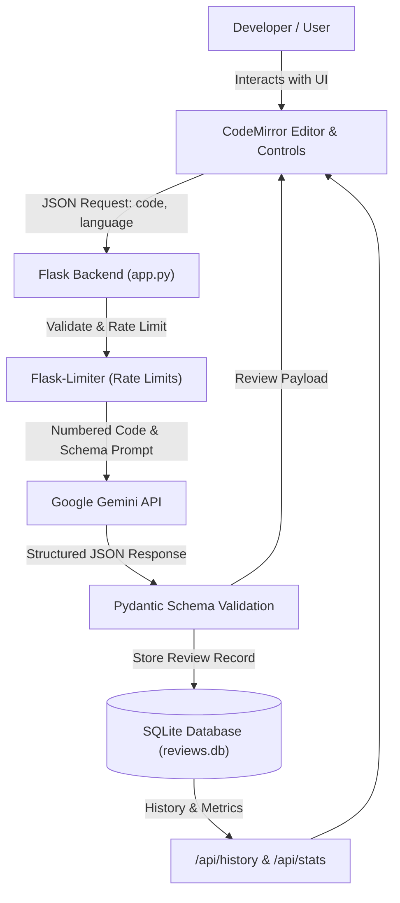

# 🚀 AI-Powered Code Reviewer

An intelligent, full-stack code review assistant powered by **Google Gemini AI**, **Flask**, and **SQLite**. It analyzes code in real time, detects bugs and security vulnerabilities, checks performance, recommends clean-code best practices, and rates overall code quality with interactive line-by-line feedback.

---

## ✨ Features

- **🎨 Professional Code Editor (CodeMirror)**
  - Syntax highlighting for **Python**, **Java**, **JavaScript**, and **C++**.
  - Dynamic mode switching as you change the target language.
  - Line numbers gutter that directly links with AI review findings.
  - Active line highlighting, bracket matching, and auto-closing pairs.
  - Quick **"Load Sample"** and **"Clear"** controls.

- **🤖 AI-Powered Analysis (Gemini API & Pydantic)**
  - Strict structured JSON output validated via **Pydantic**.
  - Severity classification: `High`, `Medium`, and `Low`.
  - Issue categorization into **Bugs**, **Security Issues**, **Performance**, and **Best Practices**.
  - Overall code quality score from **1 to 10** with visual rating badges.
  - Explicit line-number pinpointing with **interactive jump-and-flash** to highlight the exact code line in the editor.

- **📊 Analytics & Dashboard Metrics**
  - Aggregated metrics: Total reviews analyzed, average code quality score, and total issues caught.
  - **Reviews grouped by programming language** with dynamic breakdown chips (`Python`, `Java`, `JavaScript`, `C++`).
  - Automatically updates as new reviews are performed or deleted.

- **📥 Exportable Reports**
  - **Export to Plain Text (`.txt`)**: Clean ASCII-formatted report containing code quality rating, issue lists, line numbers, and fixes.
  - **Export to Markdown (`.md`)**: Formatted review reports including code snippets, findings, severity badges, and suggested fixes.
  - **Export to JSON (`.json`)**: Raw structured review data for programmatic use or integration.

- **🌓 Dark / Light Theme Toggle**
  - Seamless system-aware light and dark mode with persistent user preference in `localStorage`.
  - Dynamically synchronizes editor styling between clean light theme and Dracula dark theme.

- **📜 Per-Browser History & Deletion**
  - Lightweight, anonymous session cookie (`owner_id`) isolates history per browser without requiring user registration.
  - Re-open any previous review with a single click (restores language, code, and review findings).
  - Deletion support with immediate database removal.

- **🛡️ Security & Reliability**
  - Built-in rate limiting (`flask-limiter`) to prevent API abuse.
  - Max payload size enforcement and input validation.
  - Exponential backoff retry logic for transient API hiccups.
  - Strictly parameterized SQLite queries to prevent SQL injection.
  - DOM-safe rendering (`textContent`) preventing client-side Cross-Site Scripting (XSS).

---

## 🛠️ Technology Stack

| Layer | Technologies |
|---|---|
| **Frontend** | HTML5, CSS3 (Custom Variables), JavaScript (ES6+), CodeMirror 5 |
| **Backend** | Python 3.11+, Flask, Flask-Limiter |
| **AI Integration** | Google Gemini API (`google-genai` SDK), Pydantic v2 |
| **Database** | SQLite3 |
| **Testing** | Python `unittest` |

---

## 📐 Architecture Overview



---

## 🚀 Getting Started

### 1. Prerequisites
- Python 3.10 or higher
- A Google Gemini API key ([Get one free from Google AI Studio](https://aistudio.google.com/))

### 2. Clone and Setup Environment
```bash
# Clone the repository
git clone https://github.com/your-username/AI-Code-Reviewer.git
cd AI-Code-Reviewer

# Create and activate a virtual environment
python -m venv venv

# On Windows (PowerShell):
.\venv\Scripts\Activate.ps1
# On macOS/Linux:
source venv/bin/activate

# Install dependencies
pip install -r requirements.txt
```

### 3. Configure Environment Variables
Copy `.env.example` to `.env` and fill in your Gemini API key:
```bash
cp .env.example .env
```

Edit `.env`:
```env
GEMINI_API_KEY=your_actual_gemini_api_key_here
GEMINI_MODEL=gemini-3.8-flash
FLASK_DEBUG=1
PORT=5000
DATABASE_PATH=reviews.db
```

### 4. Run the Application
```bash
python app.py
```
Open your browser and navigate to:
```
http://127.0.0.1:5000
```

---

## 🧪 Running Tests

The application includes an automated test suite covering homepage rendering, input validation, rate limits, history CRUD operations, cross-owner data isolation, and API mocks:

```bash
python -m unittest test_app.py
```

---

## 📡 API Reference

### `POST /api/review`
Submits code for review.
- **Body**: `{"code": "def foo(): pass", "language": "Python"}`
- **Response**:
```json
{
  "id": 12,
  "review": {
    "rating": 8,
    "summary": "Clean function definition with correct syntax.",
    "language_matches": true,
    "bugs": [],
    "security": [],
    "performance": [],
    "best_practices": []
  }
}
```

### `GET /api/history`
Returns past reviews for the current browser session.

### `GET /api/history/<id>`
Fetches details of a specific past review.

### `DELETE /api/history/<id>`
Deletes a specific past review from the database.

### `GET /api/stats`
Returns aggregated review count, average ratings, issue breakdowns, and language statistics.

---

## 📋 Project Roadmap

- [x] **Phase 1: Code Editor & Syntax Highlighting** (CodeMirror integration, line numbers, dynamic mode switching)
- [x] **Phase 2: Downloadable Review Reports** (Export to Markdown and JSON)
- [x] **Phase 3: Dashboard Statistics** (Review counter, average score, issue categories breakdown)
- [x] **Phase 4: Modern UI & Dark Mode** (Theme toggle, Dracula syntax theme, responsive card UI)
- [x] **Phase 5: Automated Testing & Validation** (Comprehensive unit & isolation test suite)
- [x] **Phase 6: Security & Configuration** (Proper `.gitignore`, `.env.example`, sanitization)
- [x] **Phase 7: GitHub README & Documentation**
- [ ] **Phase 8: Production Deployment** (Render / Railway / PythonAnywhere)
- [ ] **Phase 9: GitHub Pull Request Integration** (Direct repo analysis via GitHub API)

---

## 🌐 Production Deployment

This project includes a `Procfile` and `gunicorn` configuration ready for zero-cost deployment on **Render**, **Railway**, or **PythonAnywhere**:

### Deploying on Render:
1. Push your code to a GitHub repository:
   ```bash
   git init
   git add .
   git commit -m "Initial commit of AI Code Reviewer"
   git branch -M main
   git remote add origin https://github.com/<your-username>/AI-Code-Reviewer.git
   git push -u origin main
   ```
2. Log in to [Render Dashboard](https://dashboard.render.com/) and click **New + > Web Service**.
3. Select your GitHub repository.
4. Set the following build settings:
   - **Build Command:** `pip install -r requirements.txt`
   - **Start Command:** `gunicorn app:app`
5. In **Environment Variables**, configure:
   - `GEMINI_API_KEY`: `<Your_Google_AI_Studio_Key>`
   - `GEMINI_MODEL`: `gemini-3.8-flash`
   - `FLASK_DEBUG`: `0`
6. Click **Create Web Service**. Your AI Code Reviewer will be live with a secure HTTPS URL!

---

## 📄 License
This project is open-source and available under the [MIT License](LICENSE).
